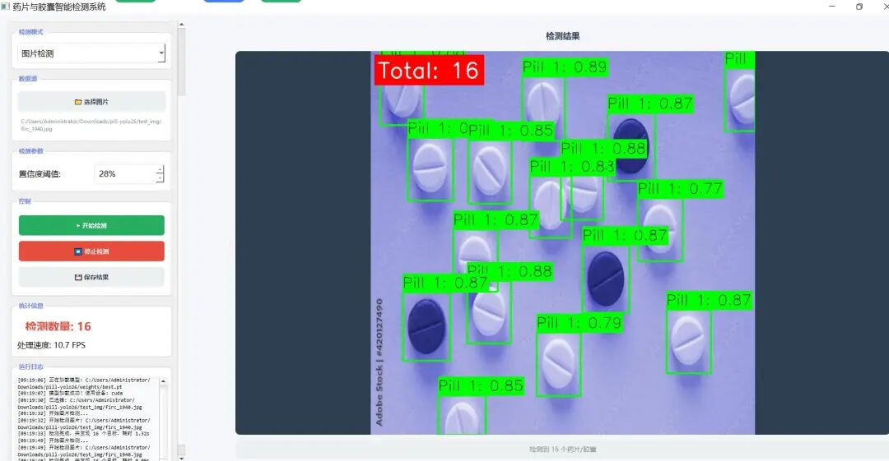
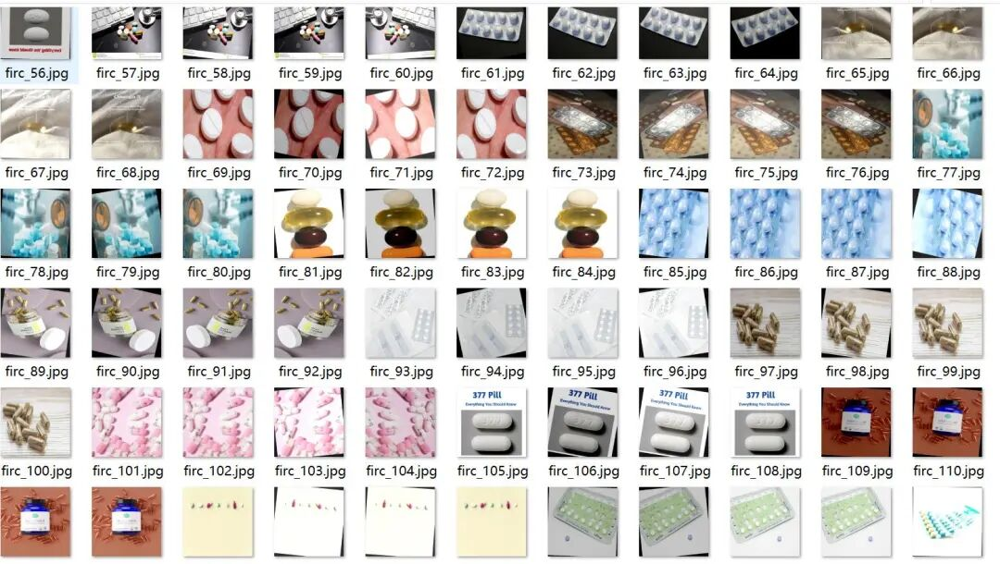
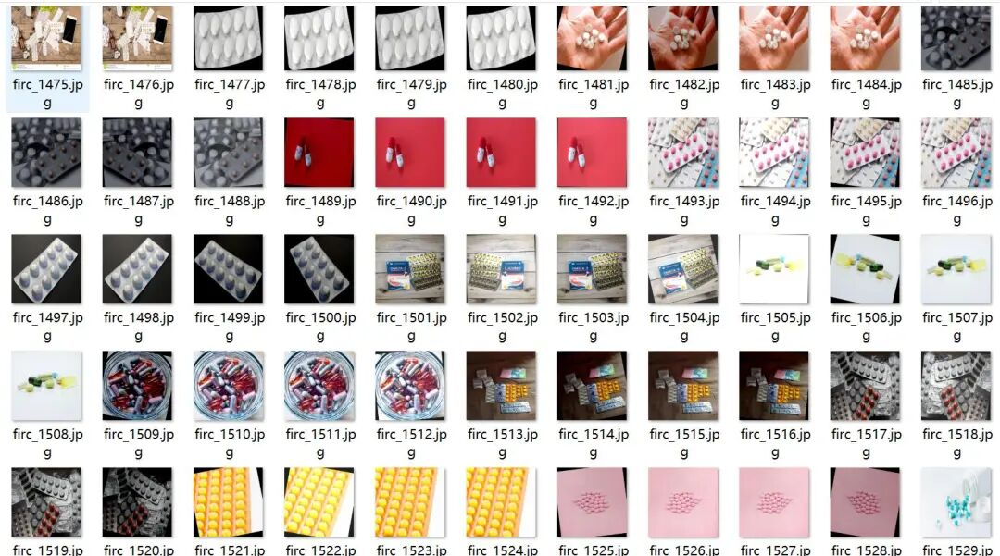
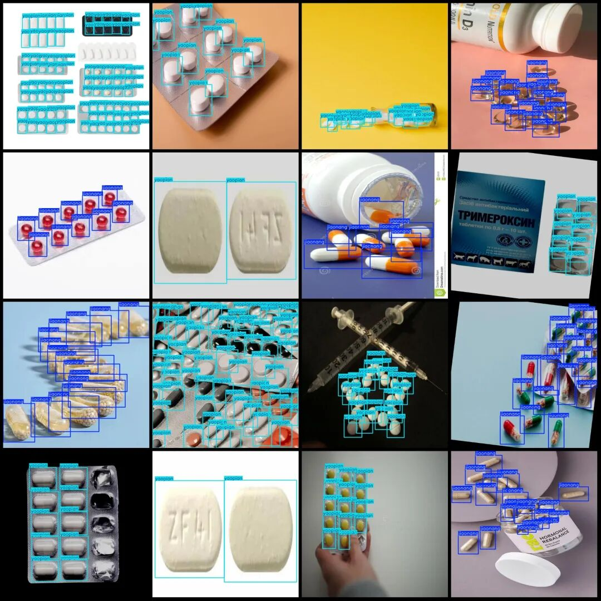

# Pharmaceutical Capsule Counting System Based on YOLOv2.6+PyQt5 + PyTorch Model + High-quality GUI Interface

[Effect Display]

[Training Dataset Introduction]

Dataset format: YOLO format (txt file without split paths, only containing jpg images and corresponding yolo format txt files)
Number of images (number of jpg files): 2017
Number of annotations (number of txt files): 2017
Training set size: 1804
Validation set size: 135
Test set size: 78
Number of annotation categories: 2
Annotation category names (note that the order in yolo format does not correspond to this, but is based on the labels folder classes.txt): ['jiaonang', 'yaopian']
Number of bounding boxes per category:
jiaonang = 15854
yaopian = 25381
Total bounding boxes = 41235
Labeling tool used: labelImg
Labeling rules: Draw a rectangle around the category
Important note: About 1100 out of the dataset are original images with rotation enhancement generated images
Special declaration: This dataset does not guarantee the accuracy of the trained model or weight files

Image Preview:

Annotation example:

[Test Environment]

windows10
anaconda3+python3.8
torch==2.3.1
ultralytics==8.4.31

The model can detect 2 categories.

Tablets and capsules

[Training Information]

|

Parameters

 ||

Value

 |

|

Number of training set images

 ||

1804

 |
|

Number of images in the validation set

 ||

135

 |
|

Training map

 ||

90.7%

 |
|

Training Accuracy

 ||

85.9%

 |
|

Training recall rate

 ||

85.7%

 |

Evaluation accuracy information for the validation set:

Name=map@50%
All=91
0 (capsule) = 87
1 (pill) = 95

[Training Steps]

To train a dataset using YOLO26, follow some basic steps. YOLO26 is a version of the YOLO series model that has made numerous improvements over its predecessors, including more efficient training processes and higher accuracy. Below are detailed steps for training your own YOLO format dataset:

1. Preparation of the environment

1.

1. Install necessary software: Ensure that Python (recommended version 3.8 or higher) is installed on your computer, as well as CUDA and cuDNN if you plan to use a GPU for acceleration.

1.

2. Install YOLOv26 library: You can clone the YOLOv8 repository on GitHub or directly install YOLO26 using pip. For example:
pip install ultralytics

II. Data Preparation

1.

3. Organize data structure: Organize your data folder according to the requirements of YOLO. Typically, you need a directory structure that includes image and label files, such as:

dataset/
├──images/
│   ├── train/
│   └── val/
├── labels/
│   ├── train/
│   └── val/

Among them, train and val represent the training set and validation set respectively. Moreover, the names of the images folder and labels folder cannot be arbitrarily modified or written incorrectly, otherwise, they will not be able to find the dataset during the training process.

1.

4. Annotation Data: Use appropriate tools to label the images, generating YOLO formatted label files. Each label file should be a .txt file, with each line representing a bounding box in the format:

<Category ID> 
 
 <Width> <Height>

These values are normalized relative to the image size.

1.

5. Create data configuration file: Create a .yaml file to define your dataset, including path, category list, etc. For example:

# dataset.yaml

Path: ./dataset
train: images/train # Training image relative path
val: images/val # Verify the relative path of the validation image

nc: 2 # Number of categories
names: ['class1', 'class2'] # Names of categories

III. Model Training

1.

6. Load pre-trained models: Use the official pre-trained models as a starting point to accelerate training speed and improve performance.

1.

7. Configure training parameters: Adjust the training parameters as needed, such as batch size, learning rate, number of training rounds, etc. This can usually be done through command-line arguments or configuration files.

1.

8. Start training: Use the command-line interface provided by YOLO11 to start the training process. For example:

yolo train data=dataset.yamlmodel=yolo11n.yaml epochs=100 imgsz=640

More parameters are as follows:

|

Parameters

 ||

Default value

 ||

Description

 |

| `model` || `None` ||

Specifies the model file for training. Accepts a path to either a `.pt` pretrained model or a `.yaml` configuration file. Essential for defining the model structure or initializing weights.

 |
| `data` || `None` ||

Path to the dataset configuration file (e.g., `coco8.yaml` ). This file contains dataset-specific parameters, including paths to training and validation data , class names, and number of classes.

 |
| `epochs` || `100` ||

Total number of training epochs. Each epoch represents a full pass over the entire dataset. Adjusting this value can affect training duration and model performance.

 |
| `time` || `None` ||

Maximum training time in hours. If set, this overrides the `epochs` argument, allowing training to automatically stop after the specified duration. Useful for time-constrained training scenarios.

 |
| `patience` || `100` ||

Number of epochs to wait without improvement in validation metrics before early stopping the training. Helps prevent overfitting by stopping training when performance plateaus.

 |
| `batch` || `16` || Batch size

 , with three modes: set as an integer (e.g., `batch=16` ), auto mode for 60% GPU memory utilization ( `batch=-1` ), or auto mode with specified utilization fraction ( `batch=0.70` ).

 |
| `imgsz` || `640` ||

Target image size for training. All images are resized to this dimension before being fed into the model. Affects model accuracy and computational complexity.

 |
| `save` || `True` ||

Enables saving of training checkpoints and final model weights. Useful for resuming training ormodel deployment.

 |
| `save_period` || `-1` ||

Frequency of saving model checkpoints, specified in epochs. A value of -1 disables this feature. Useful for saving interim models during long training sessions.

 |
| `cache` || `False` ||

Enables caching of dataset images in memory ( `True` / `ram` ), on disk ( `disk` ), or disables it ( `False` ). Improves training speed by reducing disk I/O at the cost of increased memory usage.

 |
| `device` || `None` ||

Specifies the computational device(s) for training: a single GPU ( `device=0` ), multiple GPUs ( `device=0,1` ), CPU ( `device=cpu` ), or MPS for Apple silicon ( `device=mps` ).

 |
| `workers` || `8` ||

Number of worker threads for data loading (per `RANK` if Multi-GPU training). Influences the speed of data preprocessing and feeding into the model, especially useful in multi-GPU setups.

 |
| `project` || `None` ||

Name of the project directory where training outputs are saved. Allows for organized storage of different experiments.

 |
| `name` || `None` ||

Name of the training run. Used for creating a subdirectory within the project folder, where training logs and outputs are stored.

 |
| `exist_ok` || `False` ||

If True, allows overwriting of an existing project/name directory. Useful for iterative experimentation without needing to manually clear previous outputs.

 |
| `pretrained` || `True` ||

Determines whether to start training from a pretrained model. Can be a boolean value or a string path to a specific model from which to load weights. Enhances training efficiency and model performance.

 |
| `optimizer` || `'auto'` ||

Choice of optimizer for training. Options include `SGD` , `Adam` , `AdamW` , `NAdam` , `RAdam` , `RMSProp` etc., or `auto` for automatic selection based on model configuration. Affects convergence speed and stability.

 |
| `verbose` || `False` ||

Enables verbose output during training, providing detailed logs and progress updates. Useful for debugging and closely monitoring the training process.

 |
| `seed` || `0` ||

Sets the random seed for training, ensuring reproducibility of results across runs with the same configurations.

 |
| `deterministic` || `True` ||

Forces deterministic algorithm use, ensuring reproducibility but may affect performance and speed due to the restriction on non-deterministic algorithms.

 |
| `single_cls` || `False` ||

Treats all classes in multi-class datasets as a single class during training. Useful for binary classification tasks or when focusing on object presence rather than classification.

 |
| `rect` || `False` ||

Enables rectangular training, optimizing batch composition for minimal padding. Can improve efficiency and speed but may affect model accuracy.

 |
| `cos_lr` || `False` ||

Utilizes a cosine learning rate scheduler, adjusting the learning rate following a cosine curve over epochs. Helps in managing learning rate for better convergence.

 |
| `close_mosaic` || `10` ||

Disables mosaic data augmentation in the last N epochs to stabilize training before completion. Setting to 0 disables this feature.

 |
| `resume` || `False` ||

Resumes training from the last saved checkpoint. Automatically loads model weights, optimizer state, and epoch count, continuing training seamlessly.

 |
| `amp` || `True` ||

Enables AutomaticMixed Precision
(AMP) training, reducing memory usage and possibly speeding up training with minimal impact on accuracy.

 |
| `fraction` || `1.0` ||

Specifies the fraction of the dataset to use for training. Allows for training on a subset of the full dataset, useful for experiments or when resources are limited.

 |
| `profile` || `False` ||

Enables profiling of ONNX and TensorRT speeds during training, useful for optimizing model deployment.

 |
| `freeze` || `None` ||

Freezes the first N layers of the model or specified layers by index, reducing the number of trainable parameters. Useful for fine-tuning or transfer learning
.

 |
| `lr0` || `0.01` ||

Initial learning rate (i.e. `SGD=1E-2` , `Adam=1E-3` ) . Adjusting this value is crucial for the optimization process, influencing how rapidly model weights are updated.

 |
| `lrf` || `0.01` ||

Final learning rate as a fraction of the initial rate = ( `lr0 * lrf` ), used in conjunction with schedulers to adjust the learning rate over time.

 |
| `momentum` || `0.937` ||

Momentum factor for SGD or beta1 for Adam optimizers, influencing the incorporation of past gradients in the current update.

 |
| `weight_decay` || `0.0005` ||

L2 regularization  term, penalizing large weights to prevent overfitting.

 |
| `warmup_epochs` || `3.0` ||

Number of epochs for learning rate warmup, gradually increasing the learning rate from a low value to the initial learning rate to stabilize training early on.

 |
| `warmup_momentum` || `0.8` ||

Initial momentum for warmup phase, gradually adjusting to the set momentum over the warmup period.

 |
| `warmup_bias_lr` || `0.1` ||

Learning rate for bias parameters during the warmup phase, helping stabilize model training in the initial epochs.

 |
| `box` || `7.5` ||

Weight of the box loss component in the loss_function, influencing how much emphasis is placed on accurately predicting bouding box coordinates.

 |
| `cls` || `0.5` ||

Weight of the classification loss in the total loss function, affecting the importance of correct class prediction relative to other components.

 |
| `dfl` || `1.5` ||

Weight of the distribution focal loss, used in certain YOLO versions for fine-grained classification.

 |
| `pose` || `12.0` ||

Weight of the pose loss in models trained for pose estimation, influencing the emphasis on accurately predicting pose keypoints.

 |
| `kobj` || `2.0` ||

Weight of the keypoint objectness loss in pose estimation models, balancing detection confidence with pose accuracy.

 |
| `label_smoothing` || `0.0` ||

Applies label smoothing, softening hard labels to a mix of the target label and a uniform distribution over labels, can improve generalization.

 |
| `nbs` || `64` ||

Nominal batch size for normalization of loss.

 |
| `overlap_mask` || `True` ||

Determines whether object masks should be merged into a single mask for training, or kept separate for each object. In case of overlap, the smaller mask is overlayed on top of the larger mask during merge.

 |
| `mask_ratio` || `4` ||

Downsample ratio for segmentation masks, affecting the resolution of masks used during training.

 |
| `dropout` || `0.0` ||

Dropout rate for regularization in classification tasks, preventing overfitting by randomly omitting units during training.

 |
| `val` || `True` ||

Enables validation during training, allowing for periodic evaluation of model performance on a separate dataset.

 |
| `plots` || `False` ||

Generates and saves plots of training and validation metrics, as well as prediction examples, providing visual insights into model performance and learning progression.

 |

Here, the `data` parameter points to your data configuration file, the `model` parameter specifies the model architecture used, the `epochs` setting determines the number of training iterations, and `imgsz` sets the size of input images.

IV. Monitoring and Assessment

1.

9. Monitor training process: Observe the changes in loss function to ensure that the model is learning properly.

1.

10. Model Evaluation: After training, evaluate the model's performance on the validation set, checking metrics such as mAP (Mean Average Precision).

1.

11. Adjust hyperparameters: If the model's performance is poor, it may be necessary to adjust hyperparameters, such as increasing training rounds or changing learning rates, and retrain the model.

V. Use the model

1.

12. Exporting the Model: After training, you can export the model as an ONNX or other format for deployment to different platforms. For example, converting PyTorch into an ONNX model can be done with the following command:
yolo export model=best.pt format=onnx

The table below provides a detailed overview of the configurations and options available for exporting YOLO models into different formats. These settings are for optimizing the performance of exported models. Size and cross-platform and environment compatibility are crucial. Correct configuration ensures that the model is ready to be deployed in the expected applications with optimal efficiency.

|

Parameters

 ||

Type

 ||

Default value

 ||

Description

 |

| `format` || `str` || `'torchscript'` ||

Target format for the exported model, such as `'onnx'` , `'torchscript'` , `'tensorflow'` , or others, defining compatibility with various deployment environments.

 |
| `imgsz` || `int`

 or `tuple`

 || `640` ||

Desired image size for the model input. Can be an integer for square images or a tuple `(height, width)` for specific dimensions.

 |
| `keras` || `bool` || `False` ||

Enables export to Keras format for Tensorflow SavedModel, providing compatibility with TensorFlow serving and APIs.

 |
| `optimize` || `bool` || `False` ||

Applies optimization for mobile devices when exporting to TorchScript, potentially reducing model size and improving performance.

 |
| `half` || `bool` || `False` ||

Enables FP16 (half-precision) quantization, reducing model size and potentially speeding up inference on supported hardware.

 |
| `int8` || `bool` || `False` ||

Activates INT8 quantization, further compressing the model and speeding up inference with minimal accuracy loss, primarily for edge devices.

 |
| `dynamic` || `bool` || `False` ||

Allows dynamic input sizes for ONNX, TensorRT and OpenVINO exports, enhancing flexibility in handling varying image dimensions.

 |
| `simplify` || `bool` || `True` ||

Simplifies the model graph for ONNX exports with `onnxslim` , potentially improving performance and compatibility.

 |
| `opset` || `int` || `None` ||

Specifies the ONNX opset version for compatibility with different ONNX parsers and runtimes. If not set, uses the latest supported version.

 |
| `workspace` || `float` || `4.0` ||

Sets the maximum workspace size in GiB for TensorRT optimizations, balancing memory usage and performance.

 |
| `nms` || `bool` || `False` ||

Adds Non-Maximum Suppression (NMS) to the CoreML export, essential for accurate and efficient detection post-processing.

 |
| `batch` || `int` || `1` ||

Specifies export model batch inference size or the max number of images the exported model will process concurrently in `predict` mode.

 |
| `device` || `str` || `None` ||

Specifies the device for exporting: GPU ( `device=0` ), CPU ( `device=cpu` ), MPS for Apple silicon ( `device=mps` ) or DLA for NVIDIA Jetson ( `device=dla:0` or `device=dla:1` ).

 |

Adjusting these parameters can customize the export process. To meet specific requirements. Assume deployment environment, Hardware constraints and performance objectives. Selecting the appropriate format and settings is crucial for achieving model size. The best balance between speed and precision is crucial.

Export format:

The available YOLO26 export format is as shown in the table below. You can export to any format using the `format` parameter, either `'onnx'` or `'engine'`. You can directly perform predictions or validation on the exported model, i.e., `yolo predict model=yolo26n.onnx`. After the export is completed, your model usage example will be displayed.

|

Export format

 ||

Format parameters

 ||

Model

 ||

Attribute

 ||

Parameters

 |

|

pytorch

 ||

-

 || `yolo26n.pt` ||

✅

 ||

-

 |
|

torchscript

 || `torchscript` || `yolo26n.torchscript` ||

✅

 || `imgsz`

 , `optimize` , `batch`

 |
|

onnx

 || `onnx` || `yolo26n.onnx` ||

✅

 || `imgsz`

 , `half` , `dynamic` , `simplify` , `opset` , `batch`

 |
| `openvino` || `openvino` || `yolo26n_openvino_model/` ||

✅

 || `imgsz`

 , `half` , `int8` , `batch`

 |
|

tensorrt

 || `engine` || `yolo26n.engine` ||

✅

 || `imgsz`

 , `half` , `dynamic` , `simplify` , `workspace` , `int8` , `batch`

 |
|

CoreML

 || `coreml` || `yolo26n.mlpackage` ||

✅

 || `imgsz`

 , `half` , `int8` , `nms` , `batch`

 |
|

TF SaveModel

 || `saved_model` || `yolo26n_saved_model/` ||

✅

 || `imgsz`

 , `keras` , `int8` , `batch`

 |
|

TF GraphDef

 || `pb` || `yolo26n.pb` ||

❌

 || `imgsz`

 , `batch`

 |
|

TF Lite

 || `tflite` || `yolo26n.tflite` ||

✅

 || `imgsz`

 , `half` , `int8` , `batch`

 |
|

TF Edge TPU

 || `edgetpu` || `yolo26n_edgetpu.tflite` ||

✅

 || `imgsz` |
|

TF.js

 || `tfjs` || `yolo26n_web_model/` ||

✅

 || `imgsz`

 , `half` , `int8` , `batch`

 |
|

PaddlePaddle

 || `paddle` || `yolo26n_paddle_model/` ||

✅

 || `imgsz`

 , `batch`

 |
|

MNN

 || `mnn` || `yolo26n.mnn` ||

✅

 || `imgsz`

 , `batch` , `int8` , `half`

 |
|

NCNN

 || `ncnn` || `yolo26n_ncnn_model/` ||

✅

 || `imgsz`

 , `half` , `batch`

 |

1.

13. Test Model: Test the model on new data to ensure its generalization capability is good.

The above is the basic steps to train your own dataset using YOLO26. Please adjust the specific details in these steps according to your actual situation. Hopefully, this information will be helpful to you!

[Common Evaluation Parameters Introduction]

In the task of object detection, evaluating the performance of a model is crucial. The terms you mentioned are commonly used metrics for assessing the performance of a model. Here are detailed explanations of these terms:

1.

1. **Class** : 

-

• This usually refers to the categories of objects that the model is designed to detect. For example, a model may be trained to detect different categories of objects such as vehicles, pedestrians, or animals.

1.

2. **Images** : 

-

• Represents the number of images in the validation set. The validation set is a dataset used to evaluate model performance, separate from the training set to ensure fairness in evaluation results.

1.

3. **Instances** : 

-

• The total number of target objects in all images. This includes the sum of all category objects, for example, if the validation set contains 100 images, each image has an average of 5 target objects, then the Instances is 500.

1.

4. **P (Precision)**:

-

• Precision is the ratio of true positives among the instances predicted as positive by the model. The formula is: Precision = TP / (TP + FP), where TP represents true positives and FP represents false positives.

1.

5. **R (Recall)**:

-

• Recall rate is the proportion of all true positives correctly predicted by the model. The formula is: Recall = TP / (TP + FN), where FN represents false negatives.

1.

6. **mAP50** : 

-

• Presents the mean average precision (mAP) when the IoU (Intersection over Union) threshold is set at 0.5. The IoU metric measures the degree of overlap between predicted bounding boxes and ground truth bounding boxes. mAP is a comprehensive metric that considers both precision and recall, used to evaluate the performance of models across different recall levels. At an IoU of 0.5, if the overlap between the predicted bounding box and the ground truth bounding box reaches or exceeds 50%, it is considered correct.

1.

7. **mAP50-95** : 

-

• Refers to the average accuracy of the model within the range of IoU from 0.5 to 0.95 (with a step of 0.05). This is a more stringent evaluation criterion, demanding higher overlap between predicted bounding boxes and true ones. In object detection tasks, higher IoU thresholds mean that models need to be more accurate in target object localization. The calculation of mAP50-95 takes into account multiple IoU thresholds ranging from lenient to strict, thus providing a more comprehensive assessment of model performance.

These indicators collectively form an important framework for evaluating the performance of target detection models. By comparing the performance of different models on these indicators, It can be determined which model may be more effective in practical applications.

[Usage Steps]

Usage Steps:
(1) First, install the YOLOv26 environment according to the official framework ultralytics installation tutorial and install PyQt5.
(2) After switching to your installed YOLOv26 environment, navigate to the source code directory and execute python gui.py to launch the interface, and then perform the corresponding operations.

[Provided Files]

Python source code
PyTorch model
Training map, P, R curves (in weights\results.png)
Test images (under test_img folder)

Please provide the training dataset.

## Payment

Here is a pay link on Stripe ( https://buy.stripe.com/3cs8yP7sY87d0vu9AB ). Please contact me lonlonago@foxmail.com after funding $89, and I will send you a complete data files , thank you!

